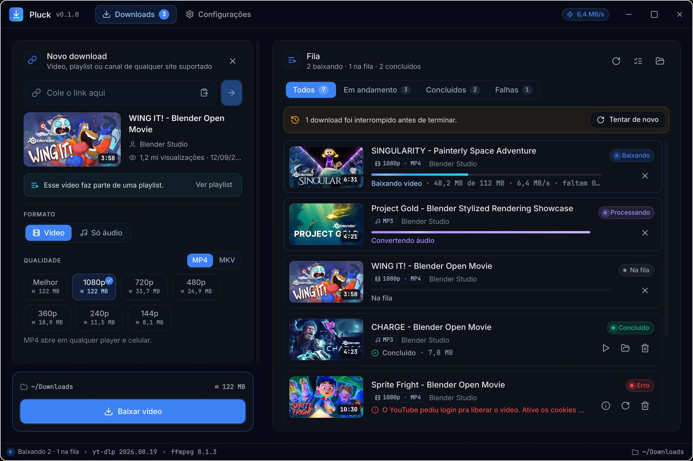
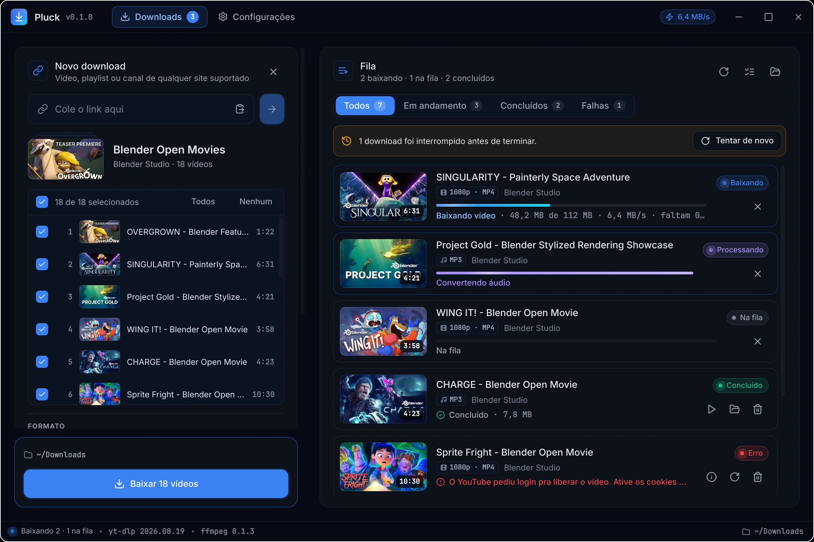
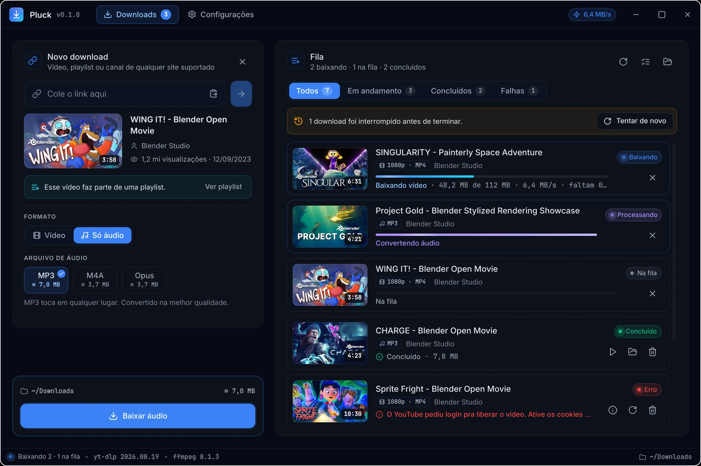
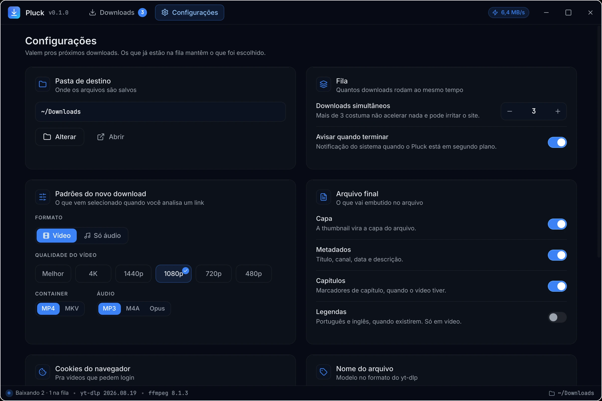
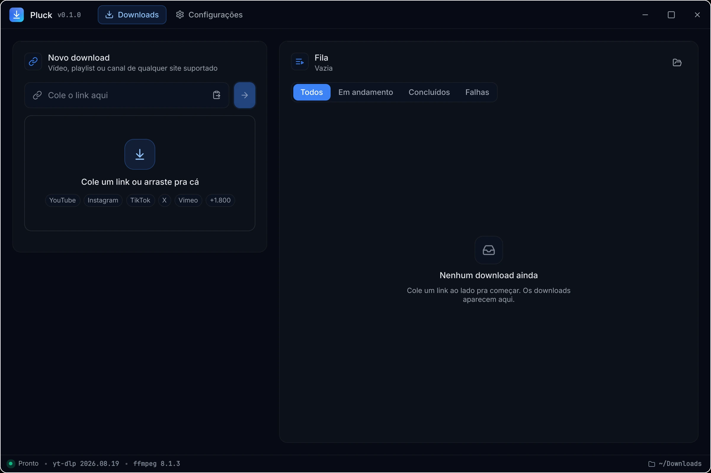

<div align="center">


# Pluck

**Interface desktop para o [yt-dlp](https://github.com/yt-dlp/yt-dlp).** Cole o link, escolha vídeo ou áudio e a qualidade, e baixe.

[](https://github.com/DevGabrielSouza/pluck/actions/workflows/ci.yml)


[](LICENSE)



</div>

## Por que o Pluck

O yt-dlp baixa de mais de 1.800 sites, mas pede linha de comando e conhecer as opções. O Pluck mostra o que importa antes de baixar e cuida do resto:

- **Prévia antes de baixar:** título, canal, duração e o tamanho estimado de cada qualidade, de 144p a 4K.
- **Vídeo ou só áudio:** MP4 ou MKV para vídeo; MP3, M4A ou Opus para áudio.
- **Playlists e canais:** escolha quais itens baixar e mande todos de uma vez.
- **Fila com histórico:** downloads simultâneos com limite configurável, velocidade, tempo restante e etapa de cada um (baixando, convertendo, juntando).
- **Nova tentativa automática:** queda de rede e erro temporário do site são repetidos com espera crescente. Cancelar nunca vira erro.
- **Arquivo completo:** capa, metadados, capítulos e legendas embutidos, conforme as configurações.
- **Vídeos que pedem login:** usa os cookies do Firefox, Chrome, Chromium, Brave, Edge, Vivaldi ou Opera.
- **Nome de arquivo do seu jeito:** modelos prontos (título, canal, data, pasta por canal) ou um modelo próprio no formato do yt-dlp.
- **Seguro com conteúdo de terceiros:** nada passa por shell, metadados do site não conseguem tirar arquivos da pasta de destino e cancelar mata o ffmpeg junto. Detalhes em [Segurança](#segurança).

## Telas

<table>
  <tr>
    <td width="50%"></td>
    <td width="50%"></td>
  </tr>
  <tr>
    <td align="center"><b>Playlist:</b> escolha os itens e baixe todos de uma vez</td>
    <td align="center"><b>Só áudio:</b> MP3, M4A ou Opus, com o tamanho antes de baixar</td>
  </tr>
  <tr>
    <td width="50%"></td>
    <td width="50%"></td>
  </tr>
  <tr>
    <td align="center"><b>Configurações:</b> pasta, fila, padrões e o que vai no arquivo</td>
    <td align="center"><b>Primeiro uso:</b> cole ou arraste um link</td>
  </tr>
</table>

## Instalação

O Pluck é testado no Fedora 44 com KDE Plasma no Wayland. Outras distribuições Linux devem funcionar com os mesmos pacotes.

**1. Dependências**

```bash
sudo dnf install python3-pyside6 yt-dlp ffmpeg nodejs
```

| Pacote | Versão | Para quê |
|---|---|---|
| Python | 3.12+ | rodar o app |
| PySide6 | 6.10+ | interface |
| yt-dlp | 2026.07.04+ | baixar; versões anteriores têm falhas de segurança conhecidas e o app avisa na barra de status |
| ffmpeg | qualquer recente | juntar vídeo e áudio, converter, embutir capa |
| Node.js | qualquer recente | o yt-dlp resolver os desafios de JavaScript do YouTube |

**2. Pluck**

```bash
git clone https://github.com/DevGabrielSouza/pluck.git
cd pluck
scripts/install.sh
```

O instalador cria o comando `pluck` em `~/.local/bin`, o atalho no menu de aplicativos e o ícone. Para remover, rode `scripts/install.sh --uninstall`.

Para só experimentar, sem instalar: `python3 -m pluck`, de dentro da pasta.

## Como usar

### Baixar um vídeo

1. Copie o link do vídeo no navegador.
2. No Pluck, aperte `Ctrl+V` fora do campo de texto, ou arraste o link para a janela. A análise começa sozinha.
3. Escolha **Vídeo**, a qualidade e o container. O tamanho estimado aparece em cada opção.
4. Clique em **Baixar vídeo**. O download entra na fila à direita.

### Só o áudio

Depois de analisar, troque para **Só áudio** e escolha MP3 (toca em qualquer lugar), M4A ou Opus (menores, mesma qualidade). Para que todo link novo já venha em áudio, mude o padrão em **Configurações › Padrões do novo download**.

### Playlist ou canal

Cole o link da playlist ou do canal. O Pluck lista os vídeos com miniatura e duração; desmarque o que não quiser e clique em **Baixar N vídeos**. Se o link for de um vídeo dentro de uma playlist, aparece **Ver playlist** para abrir a lista inteira.

### Vídeo que pede login

Quando o site exige conta (vídeo com restrição de idade, conteúdo para membros, ou o YouTube pedindo para confirmar que você não é um robô), o Pluck mostra o erro com o botão **Configurar cookies**. Escolha o navegador em que você está logado e tente de novo. Os cookies são lidos pelo yt-dlp direto do navegador; o Pluck não os copia nem guarda.

### Organizar os arquivos

Em **Configurações › Nome do arquivo**:

| Modelo | Resultado |
|---|---|
| Título [id] (padrão) | `WING IT! - Blender Open Movie [u9lj-c29dxI].mp4` |
| Canal - Título | `Blender Studio - WING IT! - Blender Open Movie.mp4` |
| Data - Título | `20230912 - WING IT! - Blender Open Movie.mp4` |
| Pasta por canal | `Blender Studio/WING IT! - Blender Open Movie.mp4` |

Também dá para escrever um modelo próprio, como `%(channel)s/%(upload_date>%Y)s/%(title)s [%(id)s].%(ext)s`. O app avisa se o modelo tentar sair da pasta de destino ou se faltar o `%(id)s`, que evita confundir dois vídeos com o mesmo título.

### Quando algo dá errado

- **Cancelar** para o download na hora, inclusive o ffmpeg. O item fica como cancelado, não como erro.
- **Tentar de novo** reaproveita o arquivo parcial quando o servidor permite continuar, e recomeça quando não permite.
- Downloads interrompidos porque o app fechou aparecem na próxima abertura, com um botão para tentar todos de novo.
- O ícone **ⓘ** num download com erro mostra a mensagem original do yt-dlp.

### Atalhos

| Atalho | Ação |
|---|---|
| `Ctrl+V` | colar o link e analisar |
| `Enter` | analisar o link digitado |
| `Ctrl+L` | ir para o campo de link |
| `Ctrl+1` | Downloads |
| `Ctrl+,` | Configurações |
| `Ctrl+Q` | sair |

## Onde ficam os dados

| O quê | Onde |
|---|---|
| Configurações | `~/.config/pluck/settings.json` |
| Histórico da fila | `~/.local/share/pluck/history.json` |
| Pasta de trabalho do yt-dlp | `~/.local/share/pluck/yt-dlp-home/` |

O Pluck não tem conta, telemetria nem servidor próprio. A rede é usada só pelo yt-dlp e para carregar as miniaturas.

O app chama o executável `yt-dlp` do sistema, então o que estiver em `~/.config/yt-dlp/config` também vale aqui. Um `yt-dlp.conf` dentro da pasta de downloads é ignorado de propósito.

## Segurança

Tudo o que vem do site (título, canal, nome de arquivo, mensagens) é tratado como não confiável:

- o yt-dlp roda como processo separado, com a lista de argumentos montada pelo app, sem shell;
- só links `http` e `https` são aceitos, e sempre depois de `--`, para não virarem opção do yt-dlp;
- campos do site usados como pasta não conseguem formar `..` e sair da pasta de destino;
- o app reconhece a saída do yt-dlp por um marcador aleatório a cada execução, que o site não consegue forjar;
- cada download roda no próprio grupo de processos, e cancelar ou fechar o app encerra também o ffmpeg e qualquer outro filho.

O modelo de ameaças, com os achados da auditoria e os riscos que continuam, está em [docs/threat-model.md](docs/threat-model.md). As defesas, uma a uma, em [docs/security.md](docs/security.md).

## Desenvolvimento

```bash
scripts/check.sh
```

Roda ruff, pyright, pytest (com o smoke de renderização de cada tela), qmllint e pip-audit. Precisa do [uv](https://docs.astral.sh/uv/) para o pyright e o pip-audit; `SKIP_AUDIT=1` pula a consulta de vulnerabilidades quando não há rede. O CI roda o mesmo script.

Os testes não acessam a internet. Os de integração usam o yt-dlp e o ffmpeg reais contra um servidor local.

As imagens deste README saem do próprio app, renderizado fora da tela com dados de exemplo:

```bash
QT_SCALE_FACTOR=2 python3 tools/screenshot.py video /tmp/video.png
```

Os cenários são `idle`, `video`, `audio`, `playlist`, `error`, `loading`, `settings` e `empty`. Os dados de exemplo ficam em `tools/showcase/`.

### Documentação

| Documento | Conteúdo |
|---|---|
| [Arquitetura](docs/architecture.md) | camadas, portas e fluxo de um download |
| [Motor de downloads](docs/download-engine.md) | estados, invariantes, processos e novas tentativas |
| [Segurança](docs/security.md) | defesas e onde cada uma está |
| [Modelo de ameaças](docs/threat-model.md) | achados da auditoria e riscos restantes |
| [Decisões (ADRs)](docs/adr/) | por que o projeto é como é |

## Créditos

- [yt-dlp](https://github.com/yt-dlp/yt-dlp) e [FFmpeg](https://ffmpeg.org), que fazem o trabalho pesado.
- Ícones do [Lucide](https://lucide.dev), licença ISC.
- As telas de exemplo mostram os [filmes abertos do Blender Studio](https://studio.blender.org/films/), sob licença Creative Commons Attribution.

## Licença

O Pluck está em domínio público, sob a [Unlicense](LICENSE), a mesma do yt-dlp. Copie, modifique, distribua e use para qualquer fim, sem precisar pedir nem citar.

Os ícones do Lucide seguem a própria licença ISC, em `pluck/icons/LICENSE-lucide`.
