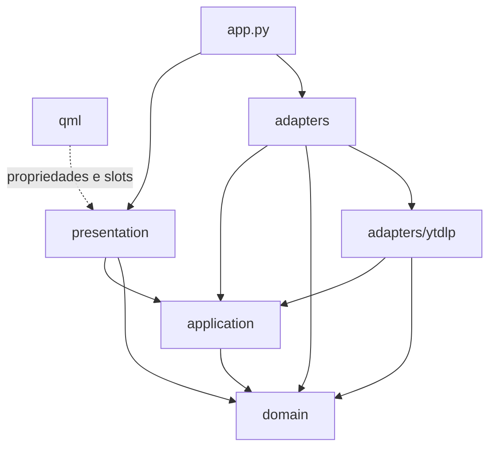

# Arquitetura

O Pluck é uma interface desktop para o executável `yt-dlp`. A interface é QML e a lógica é Python com PySide6. O download em si é sempre do `yt-dlp`, rodando como processo filho.

## Camadas

```
pluck/qml/            tela: componentes, páginas, tema. Só lê propriedades e chama slots.
pluck/presentation/   objetos Qt registrados no QML: propriedades, slots, sinais, list models, timers de tela.
pluck/application/    casos de uso sem Qt: fila de downloads, análise de link, configurações, histórico, portas.
pluck/domain/         regras puras: opções, URLs, formatos, progresso, estados do download, versão mínima.
pluck/adapters/       o que fala com o mundo: QProcess, arquivos, socket, sinais do sistema, shell do desktop.
pluck/adapters/ytdlp/ contrato da linha de comando do yt-dlp: argumentos, leitura da saída, mensagens de erro.
pluck/app.py          ponto de composição: escolhe os adapters, monta os objetos e liga o ciclo de vida.
```

As dependências apontam para dentro. O diagrama foi tirado dos imports reais:



| pacote | pode importar | não pode importar |
|---|---|---|
| `domain` | biblioteca padrão | PySide6 e qualquer outra camada |
| `application` | `domain` | PySide6, `adapters`, `presentation`, `app` |
| `adapters/ytdlp` | `domain`, `application` | PySide6, `presentation`, `app` |
| `adapters` | `domain`, `application`, PySide6 | `presentation`, `app` |
| `presentation` | `domain`, `application`, PySide6 | `adapters`, `app` |
| `app` | tudo | |

`tests/test_architecture.py` lê os imports com `ast`, falha se um deles quebrar a tabela e também se aparecer módulo fora de toda camada. A apresentação não conhece os adapters: recebe pela construção um objeto que cumpre a porta, e quem decide qual é o `app.py`.

## Portas

As portas ficam em `pluck/application/ports.py` e existem só onde há uma fronteira de verdade (ADR 0008):

| porta | quem implementa | por que é fronteira |
|---|---|---|
| `DownloadRunner`, `DownloadRun`, `RunListener` | `adapters/download_runner.py` (`QtDownloadRunner`) | processo do yt-dlp no próprio grupo: início, SIGINT e SIGKILL para o grupo, saída num canal só |
| `MediaProbe`, `Probe` | `adapters/media_probe.py` (`YtDlpMediaProbe`) | processo `yt-dlp -J` e o JSON que ele devolve |
| `JsonStore` | `adapters/storage.py` (`JsonFile`) | disco, gravação atômica em segundo plano |
| `DesktopShell` | `adapters/desktop_shell.py` (`QtDesktopShell`) | `yt-dlp --version`, `ffmpeg -version` e `gdbus` do gerenciador de arquivos |
| `JobList` | `presentation/models.py` (`DownloadListModel`) | a lista que o QML exibe; a fila altera os jobs por ela para o Qt receber `beginInsertRows` e `dataChanged` na hora certa |

`QueueListener` e `AnalysisListener` são o caminho de volta do caso de uso para a tela, e quem os cumpre são o `DownloadManager` e o `Analyzer`.

O que não ganhou porta: `Settings`, os list models, o `IconProvider`, a área de transferência e o `QDesktopServices`. São API de tela do próprio Qt, não têm segunda implementação e já são testados como estão.

## Objetos

| objeto | camada | nome no QML | papel |
|---|---|---|---|
| `Settings` | presentation | `AppSettings` | propriedades e debounce de gravação; delega a `SettingsStore` |
| `SettingsStore` | application | | valores, validação, `Preferences` de cada job |
| `Analyzer` | presentation | `Analyzer` | estado da tela de análise (`idle`, `loading`, `ready`, `error`) e `describe_media` |
| `MediaAnalysis` | application | | valida a URL, chama o probe, segue playlist aninhada, ignora resultado de análise cancelada |
| `DownloadManager` | presentation | `Downloads` | contadores, velocidade, slots da fila, timers de atualização e de gravação |
| `DownloadQueue` | application | | fila, deduplicação, limite de simultâneos, cancelamento, desfecho de cada execução, poda do histórico |
| `DownloadListModel` e `DownloadFilterModel` | presentation | `Downloads.view` | lista da fila e filtro por grupo |
| `Desktop` | presentation | `Desktop` | abrir pasta e arquivo, área de transferência, ajudantes de URL e de texto, versões das ferramentas |
| `QtDownloadRunner` | adapters | | um `QProcess` por download, leitura linha a linha, SIGINT com prazo de 3 s antes do kill |
| `YtDlpMediaProbe` | adapters | | `yt-dlp -J` e conversão da saída em dados ou `Failure` |
| `QtDesktopShell` e `send_notification` | adapters | | versões de yt-dlp e ffmpeg, `ShowItems` por D-Bus, `notify-send` |
| `YtDlpRuntime` | adapters | | executável, pasta privada e ambiente de todo processo do yt-dlp |
| `JsonFile` e `BackgroundWriter` | adapters | | leitura tolerante e gravação atômica fora da thread da interface |
| `SingleInstance` | adapters | | garante uma janela por usuário |
| `quit_on_signals` | adapters | | transforma SIGINT e SIGTERM em saída normal |

## Threads e processos

A thread da interface roda o loop do Qt e nunca espera rede ou processo:

- Todo `yt-dlp` roda em `QProcess`, e a saída chega por sinal (`readyReadStandardOutput`, `finished`).
- Gravar histórico e configurações vai para o `BackgroundWriter`, um `ThreadPoolExecutor` de um único worker. A ordem das gravações é preservada e cada uma recebe uma cópia dos dados.
- O parse do JSON da análise (`adapters/media_probe.py`) fica na thread da interface. Medido em 4 ms para um JSON de 640 KB; a análise é limitada a 1000 itens de playlist (ADR 0005).
- No encerramento, a `DownloadQueue` para de agendar, grava o histórico e pede ao runner que mate os processos, esperando até 1 s cada. Isso só acontece na saída.

## Ciclo de vida do download

Os estados e as transições permitidas ficam em `pluck/domain/jobs.py` (`TRANSITIONS`). Toda mudança passa por `DownloadJob.transition()`, que levanta `InvalidTransitionError` fora da tabela.

```
queued ──> resolving ──> downloading <──> postprocessing ──> completed
  │            │              │                 │
  │            └──────────────┴──> failed / canceled <┘
  └──> failed / canceled
failed, canceled, interrupted ──> queued   (tentar de novo, ou nova tentativa automática)
```

`completed` é final. Voltar para `queued` zera progresso, erro e horário de término. Ao abrir o app, o que estava pendente no histórico vira `interrupted`, e a tela oferece tentar de novo. O diagrama completo, os invariantes e os testes de cada um estão em `docs/download-engine.md` (ADR 0009).

## Fluxo

1. A URL colada passa por `normalize_url` e `looks_like_url` (só http e https, com host, sem caractere de controle, até 4096 caracteres).
2. A `MediaAnalysis` pede ao probe um `yt-dlp -J --flat-playlist`; se o resultado for uma lista de abas de canal, analisa de novo a primeira. O `Analyzer` passa o JSON por `describe_media` e a tela mostra formatos, tamanhos estimados e itens da playlist.
3. `Downloads.enqueue` converte cada item do QML em `JobRequest`; a `DownloadQueue` valida a URL de novo, descarta duplicata com as mesmas opções e cria os jobs em `queued`.
4. A fila inicia até `maxConcurrent` execuções pelo `DownloadRunner`, nunca duas com a mesma URL. Cada processo roda no próprio grupo de processos e tem marcadores de saída com token aleatório (`pluck/adapters/ytdlp/commands.py`); o runner lê stdout e stderr juntos, linha a linha com `split_lines` e `parse_*` e entrega à fila eventos de domínio (`ProgressUpdate`, etapa de pós-processamento, arquivo final, `RunOutcome`).
5. Na fila, o `ProgressTracker` junta as etapas (vídeo, áudio, pós-processamento) num progresso único com velocidade e tempo restante.
6. Ao terminar, o job vai para `completed`, `failed` ou `canceled`; falha transitória volta para `queued` com espera crescente (até 3 vezes), o histórico é gravado em segundo plano e, com a janela fora de foco, sai uma notificação.

## Arquivos

| arquivo | conteúdo | permissão |
|---|---|---|
| `~/.config/pluck/settings.json` | preferências | 0600 |
| `~/.local/share/pluck/history.json` | fila e histórico | 0600 |
| `~/.local/share/pluck/yt-dlp-home/` | diretório de trabalho e `home` do yt-dlp | 0700 |
| `$XDG_RUNTIME_DIR/pluck.sock` e `pluck.lock` | instância única | pasta 0700 |

A gravação é atômica: arquivo temporário na mesma pasta, `fsync`, `os.replace` e `fsync` da pasta. Falha de gravação vai para o log e não derruba o app.

## Qualidade

`scripts/check.sh` roda os mesmos passos localmente e no CI (`.github/workflows/ci.yml`):

| passo | ferramenta |
|---|---|
| lint e formatação | `ruff check`, `ruff format --check` |
| tipos | `pyright` (modo `standard`) |
| testes | `pytest`: unidade (inclusive da camada de aplicação com portas falsas, sem Qt), caracterização do comportamento anterior à ADR 0008, integração com processo falso, integração com o yt-dlp real e o ffmpeg contra servidor local, intercalação aleatória de eventos da fila, falhas e cancelamento com processos reais, corrida de instância única com processos reais, SIGTERM, smoke de renderização dos 8 cenários de tela com stderr vazio e teclado no diálogo de confirmação |
| QML | `tools/lint_qml.py` (qmllint, filtrando só os singletons registrados em runtime) |
| dependências | `pip-audit` contra as versões instaladas de PySide6 e yt-dlp |

`tools/screenshot.py` renderiza a tela fora da janela com dados de exemplo, para revisão visual.

O `pyproject.toml` declara QML, ícones e assets como dados do pacote, então `pip install .` gera um comando `pluck` que funciona fora do repositório.
