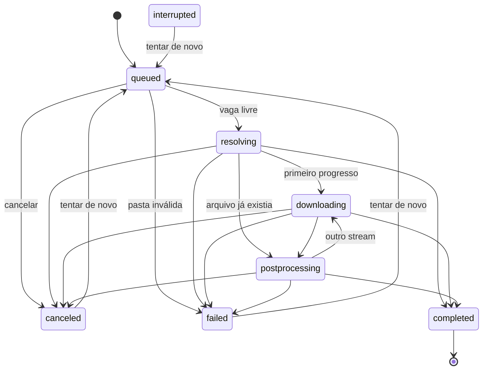

# Motor de downloads

Como um download anda, o que o motor garante e onde cada garantia é testada. As decisões estão na ADR 0009.

## Estados

`pluck/domain/jobs.py` define os estados e a tabela `TRANSITIONS`. Toda mudança passa por `DownloadJob.transition()`, que levanta `InvalidTransitionError` fora da tabela.

| estado | significado |
|---|---|
| `queued` | esperando vaga, ou esperando o horário de uma nova tentativa automática |
| `resolving` | processo iniciado, yt-dlp extraindo informações e escolhendo formatos |
| `downloading` | chegou pelo menos um evento de progresso |
| `postprocessing` | ffmpeg juntando, convertendo ou embutindo |
| `completed` | terminou com sucesso; final |
| `failed` | terminou com erro; tem mensagem |
| `canceled` | o usuário cancelou |
| `interrupted` | estava pendente quando o app fechou; só existe ao carregar o histórico |

`resolving`, `downloading` e `postprocessing` formam o grupo `RUNNING`: são os estados com processo vivo. `interrupted` fica fora de `RUNNING` porque não tem processo vivo e não é falha nem cancelamento; é ele que permite oferecer a nova tentativa depois de reiniciar.

O `history.json` passou para a versão 2. Os nomes da versão 1 (`processing`, `done`, `error`) são lidos e convertidos; uma versão anterior do app que abrir o arquivo novo descarta os registros com estado desconhecido.

## Invariantes

| # | invariante | onde é garantido | teste |
|---|---|---|---|
| 1 | Todo job em `RUNNING` tem exatamente um processo ativo, e todo processo ativo pertence a um job em `RUNNING` | `DownloadQueue._start`, `on_exit` | `test_engine.py::test_random_interleavings_keep_every_invariant` |
| 2 | Uma execução só começa com menos execuções ativas do que `maxConcurrent`; reduzir o limite não mata ninguém | `DownloadQueue.schedule` | `test_random_interleavings_...`, `test_lowering_the_limit_...` |
| 3 | Duas execuções nunca usam a mesma URL ao mesmo tempo, mesmo quando uma falha de lançamento reentra no agendador | `DownloadQueue.schedule` | `test_the_same_url_never_runs_twice_at_once`, `test_a_launch_failing_inside_start_does_not_let_one_url_run_twice` |
| 4 | Cancelamento nunca vira erro: depois de cancelar, o job termina `canceled`, ou `completed` se o processo já tinha terminado o arquivo com sucesso | `DownloadQueue._settle` | `test_cancel_ends_canceled_unless_...`, `test_cancel_wins_even_when_the_launch_fails` |
| 5 | `failed` sempre tem mensagem; `canceled` nunca tem | `DownloadQueue._fail`, `_settle` | `test_random_interleavings_...` |
| 6 | Depois do pedido de cancelamento, eventos de progresso não mudam etapa, progresso nem velocidade | `DownloadQueue._active` | `test_events_after_cancel_...` |
| 7 | Dentro de uma tentativa o progresso não diminui; antes do primeiro valor conhecido ele é indeterminado; pós-processamento não mexe nele; só `completed` marca 100%; cada tentativa nova começa do zero | `ProgressTracker._settle`, `DownloadQueue._settle`, `transition(RESOLVING)` | `test_progress_never_goes_backwards_...`, `test_postprocessing_between_streams_does_not_pin_progress_at_the_end` |
| 8 | Download de legenda não conta como stream de mídia | `ProgressUpdate.auxiliary` | `test_subtitle_downloads_do_not_count_as_a_media_stream` |
| 9 | Velocidade maior que zero só em `downloading`; o tempo restante só aparece com velocidade e soma o stream de áudio que ainda vem | `DownloadQueue._apply`, `ProgressTracker._eta` | `test_speed_exists_only_while_downloading`, `test_eta_covers_...` |
| 10 | Nova tentativa automática só para falha transitória, no máximo 3 por tentativa manual, e nunca antes do horário marcado | `DownloadQueue._schedule_automatic_retry`, `schedule` | `test_a_transient_failure_retries_...`, `test_random_interleavings_...` |
| 11 | Eventos que chegam depois do fim da execução ou do encerramento do app são ignorados | `DownloadQueue._active`, `on_exit` | `test_application.py::test_events_after_shutdown_are_ignored_and_runs_are_killed` |
| 12 | Quando uma execução ou análise termina sem sucesso, por cancelamento ou no encerramento, nenhum processo do grupo dela continua vivo | `ProcessRun`, `ProbeProcess`, `signal_group`, `AppServices.shutdown` | `test_process_engine.py`, `test_real_ytdlp.py::test_cancel_stops_the_ffmpeg_child_...` |
| 15 | Os ids dos jobs são únicos, inclusive num histórico editado | `decode_history` | `test_repeated_ids_in_a_tampered_history_are_made_unique` |
| 13 | O caminho de arquivo aceito do yt-dlp está dentro da pasta de destino do job | `ProcessRun._accept_file`, `is_inside` | `test_forged_progress_and_file_lines_are_ignored` |
| 14 | Só linhas com o token aleatório da execução viram evento | `OutputMarkers`, `parse_*` | `test_output_markers_are_unpredictable_per_run`, `test_site_metadata_cannot_forge_output_markers` |

O teste de intercalação aleatória roda 60 sementes fixas com 400 passos cada (enfileirar, cancelar, tentar de novo, remover, progresso, pós-processamento, fim com seis desfechos, relógio, limite) e confere os invariantes 1, 2, 3, 4, 5, 6, 7, 9 e 10 depois de cada passo. Cada uma das quatro mutações testadas no código da fila (tirar a guarda de URL, deixar o cancelamento perder para a falha, aceitar progresso depois de cancelar, ignorar o horário do retry) faz o teste falhar.

## Processos

Cada execução do yt-dlp roda numa sessão própria (`QProcess.UnixProcessFlag.CreateNewSession`), com os sinais restaurados ao padrão e sem herdar descritores além de 0, 1 e 2. O PID do yt-dlp é o grupo de todos os filhos dele: ffmpeg, runtime de JavaScript, downloader externo.

| situação | o que acontece |
|---|---|
| cancelar | SIGINT para o grupo; depois de 3 s, SIGKILL para o grupo |
| fim sem sucesso ou depois de cancelar | SIGKILL para o grupo, para recolher o que sobrou |
| fechar o app | SIGKILL para o grupo de cada download, espera até 1 s por execução; a análise em andamento também é cancelada |
| cancelar a análise | SIGKILL para o grupo |

O SIGINT vai para o grupo porque, medido com o yt-dlp 2026.08.19 e o downloader ffmpeg, o SIGINT só no yt-dlp não cancelou nada: o download terminou com código 0. Com o grupo, os dois saem em menos de 1 s.

## Saída do yt-dlp

stdout e stderr chegam juntos, na ordem em que o yt-dlp escreve (`MergedChannels`). O yt-dlp manda os eventos de pós-processamento para o stderr quando roda com `--quiet`. Cada linha que começa com um marcador da execução vira evento; o resto vai para a cauda de erro.

Os marcadores levam um token aleatório de 64 bits por execução (`PLUCK_PROGRESS_<token> `). O site não conhece o token. Um campo como `vcodec` com quebra de linha, que o yt-dlp repassa sem escapar, só consegue produzir uma linha sem o token, que é ignorada.

## Falhas e novas tentativas

`adapters/ytdlp/errors.py` classifica a última linha `ERROR:`:

- transitória: falha de rede (DNS, conexão recusada ou reiniciada, timeout), HTTP 5xx;
- limite de taxa: HTTP 429;
- permanente: o resto, incluindo vídeo privado ou indisponível, 403, 404, formato inexistente, disco cheio, falta de permissão.

Processo morto por sinal sem pedido de cancelamento vira `failed` com "O yt-dlp foi encerrado inesperadamente." e não é repetido.

Falha transitória volta para `queued` com a etapa "Nova tentativa (n de 3)" e espera 5, 15 e 45 s (60, 180 e 540 s quando é limite de taxa), com variação de 20% para cima ou para baixo. Cancelar, remover ou tentar de novo à mão limpa a espera e a contagem. O horário não é gravado: ao reiniciar, o job aparece como `interrupted`.

## Retomada

O Pluck não tem pausa. O yt-dlp não expõe pausa, e retomar depende de o servidor aceitar `Range`, coisa que só se sabe ao tentar. "Tentar de novo" roda o mesmo comando; o yt-dlp continua o `.part` quando o servidor permite e recomeça do zero quando não permite. `test_retrying_resumes_only_when_the_server_honors_ranges` mostra os dois casos com o yt-dlp real e um servidor local. Por isso a interface diz "Tentar de novo" e nunca "Retomar".

Os arquivos `.part` ficam na pasta de destino depois de cancelar ou falhar, porque são eles que permitem continuar.
