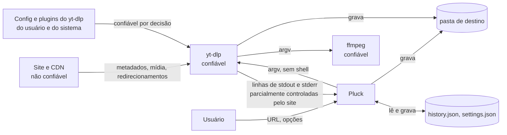

# Modelo de ameaças e auditoria do motor de downloads

Data: 18/10/2026. Versões: Pluck 0.1.0, yt-dlp 2026.08.19, ffmpeg do Fedora 44, PySide6 6.11.2.

Todos os experimentos rodaram offline, contra servidor HTTP local em 127.0.0.1 (`tests/media_server.py`) ou `--load-info-json` com metadados simulados, e com `HOME` e `XDG_CONFIG_HOME` isolados. Nenhum payload foi enviado a site de terceiros.

## Escopo

O Pluck é um app desktop de usuário único. Ele não tem servidor, não aceita conexão de rede e roda com as permissões de quem o abriu. Dentro do escopo:

- a URL colada, e tudo o que o site devolve (metadados, formatos, redirecionamentos, mensagens de erro, thumbnail, conteúdo);
- a montagem do comando do yt-dlp e a leitura da saída dele;
- o ciclo de vida dos processos filhos (yt-dlp, ffmpeg, runtime de JavaScript);
- os arquivos que o app grava e os que ele lê de volta (`history.json`, `settings.json`);
- a cadeia de build e CI.

## Ativos

| ativo | por que importa |
|---|---|
| Arquivos do usuário fora da pasta de destino | gravação ou exclusão fora dela é perda de dados |
| Arquivos já existentes dentro da pasta de destino | sobrescrita ou exclusão silenciosa |
| Cookies do navegador | dão acesso às contas do usuário |
| Tokens em URL assinada | dão acesso ao conteúdo pago ou privado |
| A conta do usuário | execução de código como ele |
| CPU, disco e rede | processo que sobrevive ao cancelamento continua gastando |
| A verdade da interface | tela que diz "concluído" ou "retomando" sem ser verdade leva a decisão errada |

## Fronteiras de confiança

- O yt-dlp e o ffmpeg do `PATH` são confiáveis: o usuário os instalou e o Pluck não tem como ser mais seguro que eles.
- A saída do yt-dlp não é confiável. Ela mistura texto do próprio yt-dlp com campos que o site escolhe.
- A config e os plugins do yt-dlp do usuário são confiáveis por decisão (ADR 0003): quem escreve em `~/.config/yt-dlp` já controla a conta. O que não é confiável é a pasta de downloads, e por isso o processo roda numa pasta privada.
- `history.json` e `settings.json` estão em pastas do usuário com modo 0600, mas são lidos como entrada não confiável, porque podem ter sido editados ou copiados de outra máquina.

## Achados

Severidade: crítico (execução de código ou perda de dados sem ação do usuário), alto (gravação ou exclusão fora do lugar com ação comum), médio (exige configuração não padrão ou entrega resultado falso), baixo (funcional, ou depende de acesso local que já é do usuário).

| # | achado | severidade | evidência | correção | teste |
|---|---|---|---|---|---|
| A1 | Cancelar não parava o download com downloader externo e deixava o ffmpeg órfão | médio | com o yt-dlp real e `--downloader ffmpeg`, SIGINT só no yt-dlp terminou com código 0 e o arquivo inteiro; SIGKILL deixou o ffmpeg com PPID 1 gravando na pasta. SIGINT no grupo cancelou os dois em 0,56 s | cada execução em sessão própria; cancelar, matar e recolher usam o grupo | `test_cancel_stops_the_ffmpeg_child_of_the_real_ytdlp`, `test_cancel_also_stops_a_grandchild_that_ignores_sigint`, `test_a_leader_that_ignores_sigint_is_killed_after_the_grace_period`, `test_shutdown_leaves_no_process_of_the_group_behind`, `test_canceling_an_analysis_stops_its_children` |
| A2 | Linhas de controle forjadas pelo site | médio | o `vcodec` vindo do site chega ao stdout com a quebra de linha intacta. Um formato com `vcodec = "mpeg4\nPLUCK_FILE /etc/hostname"` produziu a linha `PLUCK_FILE /etc/hostname`, que o app aceitaria como arquivo baixado | marcadores com token aleatório de 64 bits por execução; caminho fora da pasta do job é descartado | `test_site_metadata_cannot_forge_output_markers`, `test_forged_progress_and_file_lines_are_ignored`, `test_output_markers_are_unpredictable_per_run`, `test_reported_files_must_live_inside_the_download_folder` |
| A3 | Campo do site usado como pasta no modelo de nome grava fora da pasta de destino | médio | com o modelo `%(uploader)s/%(title)s.%(ext)s`, o yt-dlp real gravou `clip.mp4` na pasta acima da de destino com `uploader` igual a `..` e a `..\t` (a sanitização apaga o caractere de controle). Com `--restrict-filenames` na config do usuário, também com `日..`, `．．`, `.. ` e `..` seguido de espaço de largura zero. Com `%(uploader).2s`, `..evil` vira `..`. Com `%(uploader\|a/..)s`, a barra no padrão cria o componente. Só acontece com modelo personalizado | campos que formam sozinhos um componente de pasta passam por `--replace-in-metadata CAMPOS '^[\W_]*$' _`, e o comando fixa `--no-restrict-filenames --no-windows-filenames` para a sanitização ser previsível; campo de pasta com precisão, conversão diferente de `s` e `d`, barra dentro de `%()` ou padrão só de pontos torna o modelo inseguro, e ele volta ao padrão | `test_dot_dot_metadata_cannot_climb_out_of_the_folder` (seis valores, com e sem `--restrict-filenames`, e um controle sem a proteção que escapa), `test_a_truncated_directory_field_cannot_turn_into_dot_dot`, `test_directory_components_made_only_of_site_fields_are_guarded`, `test_directory_fields_that_cannot_be_guarded_make_the_template_unsafe`, `test_a_path_separator_inside_a_field_makes_the_template_unsafe` |
| A4 | Thumbnail do histórico ou do site com esquema local | baixo | `history.json` editado com `file:///…`, `image://…` ou `qrc:` fazia o `Image` do QML ler recurso local | só http e https chegam ao QML, no histórico, na fila e na análise | `test_tampered_history_cannot_point_thumbnails_at_local_resources`, `test_thumbnails_only_load_from_the_web` |
| A5 | Entrada relativa no `PATH` resolvia o executável a partir do diretório atual | baixo | `PATH=.:…` com um `yt-dlp` falso no diretório atual era escolhido pelo `shutil.which` | só entradas absolutas do `PATH`; sem achar, o caminho devolvido continua absoluto, para o `QProcess` não refazer a busca; vale para yt-dlp, ffmpeg, `notify-send` e `gdbus` | `test_relative_path_entries_never_resolve_an_executable` |
| A6 | Etapa de pós-processamento nunca aparecia e poluía a mensagem de erro | baixo | com `--quiet`, o yt-dlp real manda o `--progress-template postprocess:` para o stderr | stdout e stderr num canal só, na ordem | `test_postprocessing_reported_on_stderr_reaches_the_state_machine`, `test_a_real_download_walks_through_every_state` |
| A7 | Cancelamento podia virar erro | baixo | uma falha ao lançar o processo depois do pedido de cancelamento terminava em `error` | cancelamento vence qualquer falha; só perde para arquivo já concluído | `test_cancel_wins_even_when_the_launch_fails`, `test_cancel_ends_canceled_unless_the_file_was_already_finished` |
| A8 | "Retomar" prometia continuar do ponto | baixo | com servidor sem `Range`, o yt-dlp real diz "Unable to resume" e recomeça do zero | "Tentar de novo" em todo lugar, inclusive no diálogo de fechar o app; a continuação fica com o `--continue` do yt-dlp, quando o servidor permite | `test_retrying_resumes_only_when_the_server_honors_ranges` |
| A9 | Legenda levava a barra a 100% antes do vídeo | baixo | o yt-dlp real reporta legenda com `format_id`, `vcodec` e `acodec` como `NA` | progresso de legenda vira etapa auxiliar | `test_subtitle_downloads_do_not_count_as_a_media_stream` |
| A10 | Queda de rede encerrava o download de vez | baixo | DNS, conexão recusada e 5xx terminavam em `error` sem nova tentativa | até 3 tentativas com espera crescente, só para falha transitória | `test_a_transient_failure_retries_with_growing_backoff_and_then_gives_up`, `test_a_transient_failure_is_retried_automatically` |

### Achados da revisão

A revisão independente (Codex `gpt-5.6-sol` em `xhigh` para corretude, revisão adversarial do Codex em `xhigh` e um revisor de invariantes) encontrou o que segue nas correções acima. Tudo foi reproduzido antes de corrigir, e cada teste falha sem a correção.

| # | achado | severidade | origem | correção | teste |
|---|---|---|---|---|---|
| A11 | Fechar o app com uma análise em andamento deixava os filhos do yt-dlp vivos | médio | adversarial | o encerramento cancela a análise, que mata o grupo | `test_closing_the_app_stops_a_running_analysis_and_its_children` |
| A12 | Uma falha de lançamento dentro de `start()` reentrava no agendador, que iniciava duas execuções da mesma URL | médio | revisor de invariantes | o agendador recalcula as URLs ocupadas a cada job | `test_a_launch_failing_inside_start_does_not_let_one_url_run_twice` |
| A13 | Ids repetidos num `history.json` editado deixavam um job preso em `resolving` e um processo sem dono | médio | revisor de invariantes | id repetido ganha um novo ao carregar | `test_repeated_ids_in_a_tampered_history_are_made_unique` |
| A14 | Pós-processamento entre dois streams fixava a barra em 100% até o fim | baixo | Codex | pós-processamento mantém o progresso; só a conclusão marca 100% | `test_postprocessing_between_streams_does_not_pin_progress_at_the_end` |
| A15 | Filtro "Concluídos" vazio aparecia sem título nem descrição | baixo | Codex | chaves do estado vazio renomeadas para `completed` | `test_every_scenario_renders_without_qml_warnings[empty]`, que agora passa por todos os filtros |
| A16 | Pasta escrita com `//` no início fazia o arquivo reportado parecer fora dela | baixo | Codex | pasta e caminho normalizados do mesmo jeito | `test_a_folder_spelled_with_a_double_slash_still_contains_its_files` |

Os detalhes do motor de downloads, com os invariantes e onde cada um é testado, estão em `docs/download-engine.md`.

## Verificado sem achado

| área | o que foi verificado |
|---|---|
| `shell=True` e injeção em subprocesso | o app não usa shell: `QProcess` com lista de argumentos. Os únicos `subprocess.run` estão em `tools/` e `scripts/`, com lista fixa |
| Injeção de opção pela URL | a URL vai depois de `--`, precisa ser http ou https com host, sem espaço nem caractere de controle |
| Argumentos montados com dados do usuário | idiomas de legenda passam por regex fechada; navegador de cookies vem de lista; `%` da pasta vira `%%`; o modelo de nome passa por `safe_filename_template` |
| Protocolos e redirecionamentos | redirecionamento para `file://` é recusado pelo próprio yt-dlp ("No connection adapters"). O Pluck só aceita http e https na entrada |
| SSRF | não se aplica ao download: o app não tem servidor e faz requisições na rede do próprio usuário, a pedido dele. O único pedido feito sem clique é a thumbnail que o site indica; ela pode apontar para um IP da rede local (ver riscos restantes) |
| Nomes de arquivo | o yt-dlp troca `/` e `\` nos campos e limita o tamanho com `--trim-filenames 180`. `..` como nome de arquivo inteiro não é possível porque o modelo sempre termina em `.%(ext)s` |
| Sobrescrita | o yt-dlp não sobrescreve um arquivo final que já existe; considera "já baixado" (ver riscos restantes) |
| Config plantada na pasta de downloads | o processo roda em pasta privada 0700 (ADR 0003); `yt-dlp.conf` com `--exec` na pasta de destino é ignorado (`test_process_isolation.py`) |
| Plugins | o yt-dlp carrega plugins da config do usuário, do sistema, do `site-packages` e do `PYTHONPATH`, nunca do diretório de trabalho, que é privado. Plugin do usuário é confiável pela mesma regra da config |
| Cookies | o Pluck só passa o nome do navegador; quem lê o banco é o yt-dlp. O Pluck não lê, guarda nem registra cookies |
| Logs e mensagens | o detalhe de erro passa por `redact`; o log só registra o caminho de arquivo recusado. Nenhum log grava URL completa nem cookie |
| Atualização | o Pluck não se atualiza nem roda `yt-dlp -U`. A versão vem do sistema ou do pip, e a barra de status avisa abaixo da mínima segura (`docs/security.md`) |
| Descritores herdados | o processo filho só recebe 0, 1 e 2 (`CloseFileDescriptors`) |

## Supply chain

| item | estado |
|---|---|
| Dependências Python | só `PySide6`; o yt-dlp é executável externo. `pip-audit` roda no CI contra as versões instaladas |
| Dependabot | ativo para pip e GitHub Actions |
| GitHub Actions | fixadas por SHA desde esta auditoria, com a versão em comentário para o Dependabot; `permissions: contents: read`; o checkout não guarda o token (`persist-credentials: false`) |
| Ferramentas do CI | `pyright` e `pip-audit` vêm do `uvx` sem versão fixa, e o `pip install` do CI pega a versão mais nova. Só rodam no CI, sem segredo disponível |

## Controles descartados

| controle | por que não |
|---|---|
| `--ignore-config` e `--no-plugin-dirs` | quebram config legítima, como `--js-runtimes`, e plugins de token do YouTube |
| Recusar modelos com campo do site como pasta | `%(uploader)s/%(title)s` é uso comum; a proteção do A3 resolve sem recusar |
| Bloquear thumbnail de IP privado | quebra servidores de mídia na rede local |
| Apagar `.part` ao cancelar | perde o que permite continuar e arrisca apagar arquivo do usuário |
| Pasta temporária para o download inteiro | resolveria R1, R2 e R3, mas exige mover entre sistemas de arquivos, refazer o isolamento da ADR 0003 e baixar de novo tudo o que já existe (ADR 0009) |
| Recusar modelo sem `%(id)s` | `%(title)s.%(ext)s` é uso comum; a tela avisa (R2) |
| Manter `--restrict-filenames` da config com modelo que usa campo do site como pasta | a sanitização restrita transforma valores com letra em `..` (`日..`), e não há regex que preveja isso sem trocar nomes legítimos em outros alfabetos |
| Resolver symlinks na checagem de contenção | uma pasta de destino com subpasta que é link para outro disco é uso legítimo |

## Riscos restantes

| # | risco | severidade | evidência | por que ficou |
|---|---|---|---|---|
| R1 | Com `--embed-thumbnail`, um arquivo do usuário com o mesmo nome-base da capa é apagado | baixo com o modelo padrão, médio com modelo sem o id | um `victim.jpg` existente na pasta foi apagado ao baixar um vídeo com título `victim`. `--no-overwrites` piora (embute a imagem do usuário) e `-o "thumbnail:…"` não muda, porque o yt-dlp grava a capa primeiro ao lado do arquivo | o modelo padrão inclui `[%(id)s]`, o que torna a colisão improvável; a proteção do A3 limita o efeito à pasta de destino. Isolar exigiria a pasta temporária descartada acima |
| R2 | Com modelo sem o id, um arquivo existente com o mesmo nome conta como baixado e passa pelo pós-processamento | médio com modelo sem o id, baixo com o padrão | no modo áudio, com `%(title)s.%(ext)s` e um `Song.webm` do usuário na pasta, o job terminou concluído, o `Song.webm` foi apagado e ficou um `Song.mp3`. No modo vídeo, o `Clip.mp4` do usuário é regravado com os metadados do site | as Configurações avisam quando o modelo não tem `%(id)s`. O comportamento é do yt-dlp, e as opções que mudariam isso (`-k`, `--force-overwrites`) deixam lixo ou trocam o arquivo do usuário pelo do site |
| R3 | Um `.part` que já é symlink faz o yt-dlp gravar no destino do link | baixo em pasta privada, médio em pasta compartilhada ou sincronizada | `Downloads/clip [clip1].mp4.part` apontando para um arquivo fora da pasta: o yt-dlp real continuou o download escrevendo no fim desse arquivo. Um symlink no lugar do arquivo final não é seguido (vira "já baixado") | exige que alguém consiga criar links na pasta de destino (o próprio usuário, ou outra pessoa numa pasta compartilhada ou sincronizada) e também controle o site, para acertar o nome. A correção certa é o yt-dlp abrir o `.part` sem seguir link |
| R4 | A thumbnail indicada pelo site é buscada sem clique, inclusive em IP da rede local | baixo | o `Image` do QML faz um GET para a URL da capa ao mostrar a análise | é um GET sem cookie nem corpo; bloquear quebraria servidores locais |
| R5 | A config do yt-dlp do usuário pode ter `--exec`, downloader externo ou `--netrc-cmd` | baixo | config real deste ambiente tem `--js-runtimes node`, que é legítimo | fronteira confiável por decisão; o ganho do A1 vale também para esses processos, que morrem com o grupo |
| R6 | URL colada fica no `history.json` como foi colada, inclusive com token | baixo | o arquivo é 0600 e o detalhe de erro mostrado na tela é mascarado | a URL é necessária para tentar de novo |
| R7 | Recolher o grupo logo depois da saída do yt-dlp tem janela teórica de reuso de PID | baixo | o Linux não reaproveita o PGID enquanto algum membro existe; o sinal sai no mesmo ciclo do evento de término | não há como fechar sem `pidfd` para grupo |
| R8 | Uma versão anterior do Pluck que abrir o `history.json` v2 descarta os registros `completed` e `failed` e regrava o arquivo | baixo | `decode_history` não olha o campo `version` | afeta só o histórico, não os arquivos; recusar gravar quando a versão do arquivo for maior que a do app evita repetir isso numa v3 |
| R9 | Com modelo que usa campo do site como pasta, o `--restrict-filenames` da config do usuário deixa de valer | baixo | o comando fixa `--no-restrict-filenames` nesses casos (A3) | é o preço de a proteção ser completa; o modelo padrão não é afetado |

Sugestão para o projeto yt-dlp, a decidir pelo autor do Pluck: R3 e o caso do A3 (campo que vira `..` depois da sanitização, usado como pasta) podem ser relatados upstream. Nada foi enviado.
